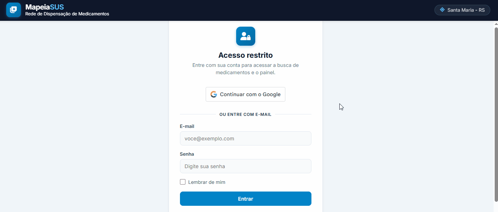

# MapeiaSUS



## Acesso

https://mapeiasus-34cn.onrender.com

## Desenvolvedor

Carlos Eduardo Velozo, Ciência da Computação.

## Proposta

Este projeto é uma continuação do MapeiaSUS do projeto 2. Na versão anterior a aplicação era uma busca pública: o usuário digitava um medicamento e via no mapa as farmácias que podiam entregá-lo. Agora eu fechei o ciclo de uso: existe cadastro e login, área restrita para administradores e persistência em banco de dados no Render.

A diferença principal é que os dados deixaram de ser só consultados. No painel eu cadastro farmácias e medicamentos, associo os itens disponíveis em cada unidade e controlo quem pode acessar a aplicação.

## Desenvolvimento

### Processo

Comecei mantendo a estrutura que já funcionava: Flask, consulta de medicamentos, mapa com Leaflet e histórico de buscas. Sobre isso montei a autenticação por e-mail e senha com Flask-Login. Guardei apenas o hash da senha no banco e tomei cuidado para não revelar se um e-mail existe ou não: qualquer falha devolve a mesma mensagem.

Depois acrescentei o login com Google. O botão no navegador devolve um ID token e quem decide se a conta é válida é o servidor: verifico assinatura, audiência, emissor e se o e-mail foi confirmado. Se o usuário já tiver conta com aquele e-mail, eu vinculo o Google nela, se não estiver crio uma conta nova.

No painel administrativo fiz o CRUD de farmácias e medicamentos. Uma mudança que melhorou bastante o cadastro foi trocar os campos de coordenadas por um clique no mapa. O marcador é arrastável, aparece no lugar certo quando edito uma farmácia e ainda posso usar a localização atual do aparelho. Também criei uma aba para adicionar e remover administradores, com bloqueio para não remover a própria conta, o último administrador ou os e-mails definidos nas variáveis do Render.

No deploy eu aprendi na prática a configurar o plano gratuito do Render: web e Postgres free, sem disco persistente, build com os scripts de banco e admin inicial. Duas limitações do plano que eu contornei: o banco free expira depois de 30 dias e as fotos enviadas desaparecem a cada deploy, então passei a usar a URL da imagem quando preciso de algo fixo.

Um dos problemas mais chatos foi ser deslogado ao salvar uma farmácia. O Flask-Login estava com a proteção de sessão no modo `strong`, que compara IP e User-Agent; como o proxy do Render muda o IP repassado entre uma requisição e outra, a sessão era apagada justo no envio do formulário. Troquei para `basic` e o cadastro passou a funcionar normalmente.

### Trechos de código

O primeiro trecho é o login com e-mail e senha. Aqui eu confiro a conta e a senha, promovo a administrador os e-mails configurados e limpo a sessão antes de autenticar:

```python
# auth/routes.py
utilizador = (
    db.session.query(User)
    .filter(db.func.lower(User.email) == email)
    .first()
)

if (
    utilizador is None
    or not utilizador.ativo
    or not utilizador.verificar_senha(form.senha.data)
):
    flash("E-mail ou senha inválidos.", "error")
    return render_template("auth/login.html", form=form)

admins = current_app.config.get("ADMIN_EMAILS") or []
if email in admins and not utilizador.is_admin:
    utilizador.role = "admin"
    db.session.commit()

session.clear()
login_user(utilizador, remember=form.lembrar.data)
```

Este segundo trecho é o login federado. O ID token vem do Google, mas a validação acontece no servidor, com a biblioteca oficial do Google:

```python
# auth/google.py — valida o ID token recebido do botão do Google
info = id_token.verify_oauth2_token(
    credential,
    google_requests.Request(),
    audience=client_id,
    clock_skew_in_seconds=60,
)
if info.get("iss") not in ISSUERS_VALIDOS:
    return None
if info.get("email_verified") not in (True, "true"):
    return None

# auth/routes.py — vincula pelo "sub" ou reaproveita uma conta com o mesmo e-mail
utilizador = User.query.filter_by(google_sub=google_sub).first()
if utilizador is None:
    utilizador = (
        db.session.query(User)
        .filter(db.func.lower(User.email) == email)
        .first()
    )
    if utilizador is not None:
        utilizador.google_sub = google_sub
```

O terceiro trecho é o conserto do logout no cadastro de farmácia. Foi uma linha, mas entendi melhor como o Flask-Login protege a sessão:

```python
# extensions.py
# "strong" remove a sessão se o X-Forwarded-For variar entre requisições no proxy.
login_manager.session_protection = "basic"
```

## Tecnologias

### Linguagens e afins

- Python
- Flask, Flask-Login, Flask-WTF e Flask-SQLAlchemy
- PostgreSQL com psycopg
- HTML, CSS e JavaScript
- Jinja2 para os templates
- Leaflet para os mapas
- Google Identity Services para o login federado
- Gunicorn para servir a aplicação no Render
- python-dotenv para as variáveis locais

### Ambiente de desenvolvimento

- Visual Studio Code
- Python em ambiente virtual (venv)
- Git e GitHub
- Render para hospedar a aplicação e o banco
- Navegador para testar login, mapa e painel

## Referências e créditos

- Créditos ao Miguel Brondani, que forneceu a lista de medicamentos e os endereços das farmácias usados desde o projeto anterior
- https://flask.palletsprojects.com/
- https://flask-login.readthedocs.io/
- https://flask-wtf.readthedocs.io/
- https://leafletjs.com/reference.html
- https://developers.google.com/identity/gsi/web
- https://render.com/docs
- https://developer.mozilla.org/en-US/docs/Web/HTML
- https://developer.mozilla.org/en-US/docs/Web/CSS
- https://developer.mozilla.org/en-US/docs/Web/JavaScript


---
Projeto entregue para a disciplina de [Desenvolvimento de Software para a Web](http://github.com/andreainfufsm/elc1090-2026b) em 2026b
